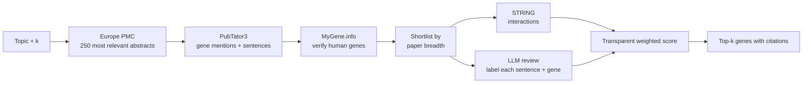

# Gene Prioritizer

**Enter a biomedical topic and a number _k_. Get the top-_k_ human genes, ranked from PubMed literature with LLM evidence review and a citation for every claim.**

🔗 **Live demo:** https://ramya2003-cyber.github.io/gene-prioritization/ &nbsp;·&nbsp; **API:** https://gene-prioritizer-api.onrender.com/docs


## What it does

| Input | Output |
|---|---|
| A topic such as `ferroptosis`, `Alzheimer's disease` or `hypoxia`, plus _k_ (1–50) | A ranked list of human genes. Each gene has an LLM relevance label (core / supporting / peripheral / unrelated), a one-line rationale citing PubMed IDs, the exact evidence sentences, a transparent score breakdown, and an interaction network. Results can be exported as CSV or JSON. |

## How it works



1. **Retrieve:** Europe PMC returns relevance-ordered PubMed IDs whose title or abstract mentions the topic.
2. **Annotate:** PubTator3 tags gene mentions with NCBI Gene IDs. The app keeps the sentence each mention appears in.
3. **Verify:** MyGene.info keeps only confirmed human genes (taxon 9606), with their official symbols.
4. **LLM evidence review:** the model receives the topic and, for each shortlisted gene, up to three exact sentences. It returns strict JSON:
   - a relevance label for the gene
   - a label for each sentence: direct finding, indirect, or background
   - a short rationale that cites passage IDs, which are converted into PubMed links
5. **Rank:** the final score is

   ```
   score = 0.40·literature + 0.40·LLM relevance + 0.15·LLM evidence + 0.05·network
   ```

   The network term is deliberately small, so highly connected "hub" genes (TP53, AKT1…) cannot outrank genes the literature is actually about.

### How the weights were chosen
The weights are set by hand. I tested them against **learned weights from a pairwise learning-to-rank model**, trained on 251 KEGG pathway cases and evaluated with 5-fold cross-validation by pathway (details in [`training/`](training/README.md)):

| Ranking (held-out pathways) | Gene precision@10 | Pathway R@1 | MRR |
|---|---:|---:|---:|
| Paper count only | 0.580 | 0.725 | 0.799 |
| **Hand-set weights (used)** | **0.631** | 0.777 | 0.836 |
| Learned: literature + LLM evidence | 0.606 | 0.793 | 0.841 |
| Learned: + network signals | 0.650 | 0.701 | 0.778 |

- **Network signals:** the learner gave them a large weight, which selected slightly more pathway members but cut pathway recovery by 7.6 points (significant).
- **Without network signals:** the learned model tied the hand-set weights on pathway recovery but was worse on precision.
- **Result:** the hand-set weights were kept. The LLM relevance term has no saved equivalent, so it is not covered by this test.

### LLM guardrails
- The model judges **only the sentences it is given**, with temperature 0 and JSON output.
- **Every item is validated.** Unknown genes, made-up passage IDs and invalid labels are dropped and listed in the run notes.
- **Partial failures degrade gracefully.** A failed or rate-limited batch only affects its own genes, which fall back to literature signals. If no key is configured, the whole app runs in a clearly labelled "literature only" mode.
- **No gene is invented.** If fewer than _k_ human genes are found, the shortfall is reported.
- **Usage is bounded:** at most 4 LLM calls per search, a per-IP hourly rate limit, a 24 h result cache and a limit on concurrent searches.

### Provider-agnostic, free LLM
The backend calls any **OpenAI-compatible** chat endpoint. The default is the **Google Gemini free tier**. Groq, Mistral or OpenRouter can be used by changing three environment variables (see [`.env.example`](.env.example)).

## Architecture

```
frontend/   static HTML/CSS/JS (no build step) → GitHub Pages
            live progress via Server-Sent Events, network graph in SVG,
            precomputed examples in frontend/examples/ that load even if the backend sleeps
backend/    FastAPI (Python 3.11)            → Render / Hugging Face Spaces / any Docker host
  app/http.py        retrying HTTP client (backoff on 429/5xx, honours Retry-After)
  app/literature.py  Europe PMC + PubTator3 + MyGene
  app/network.py     STRING interactions
  app/llm.py         prompt, batched calls, JSON parsing and validation
  app/ranking.py     transparent additive scoring
  app/pipeline.py    orchestration, caching, progress events
  app/main.py        REST + SSE endpoints, CORS, rate limiting
  tests/             offline tests (all external APIs mocked)
```

**API**
- `GET /api/health`: status and the configured model.
- `GET /api/rank/stream?topic=ferroptosis&k=10`: an SSE stream of `progress` events, then `result` (or `failure`).
- `POST /api/rank` with `{"topic": "ferroptosis", "k": 10}`: the same result as plain JSON.
- Interactive docs are served at `/docs`.

## Run locally

```bash
# backend
cd backend
pip install -r requirements.txt
cp ../.env.example ../.env          # then add your free Gemini key to LLM_API_KEY
uvicorn app.main:app --reload       # http://127.0.0.1:8000/docs
python -m pytest -q                 # offline tests

# frontend (second terminal)
cd frontend
python -m http.server 5500          # http://127.0.0.1:5500 (talks to the local backend automatically)
```

Regenerate the instant examples with `python scripts/precompute_examples.py "ferroptosis" "Alzheimer's disease" "hypoxia"`.

## Deploy (free)

1. **Backend on Render:** Dashboard → *New* → *Blueprint* → select this repo (it uses `render.yaml`). Set `LLM_API_KEY` when prompted. A `Dockerfile` is also included for Hugging Face Spaces or other Docker hosts.
2. **Frontend on GitHub Pages:**
   - Put the backend URL into `frontend/config.js`.
   - Under repo *Settings → Pages → Source*, choose **GitHub Actions**.
   - Push to `main`. The workflow publishes `frontend/`.
3. Optionally, set `ALLOWED_ORIGINS` on the backend to your Pages URL.

The free Render tier sleeps after inactivity, so the first search after a break takes about a minute to wake the server. The precomputed examples always load instantly.

## Limitations
- Only a relevance-ordered sample of 250 abstracts is read, so rare or recently reported genes can be missed.
- PubTator gene recognition can mis-tag abbreviations; the LLM review is there to catch these.
- LLM labels are model judgements, not expert curation. Scores rank literature evidence and are **not** probabilities of causality.
- For research exploration only, not clinical use.

## Background
This app is a production-oriented spin-off of my research on literature-based gene prioritization. That work compared GF-IDF, learning-to-rank and evolution-strategy rankers on KEGG pathway-recovery benchmarks. The earlier evolution-strategy (ES) weights over-rewarded network hub genes on live topics: for example, TP53 ranked #1 for *ferroptosis*, ahead of GPX4. This version replaces them with an LLM evidence layer and a capped network term.

## License
MIT
