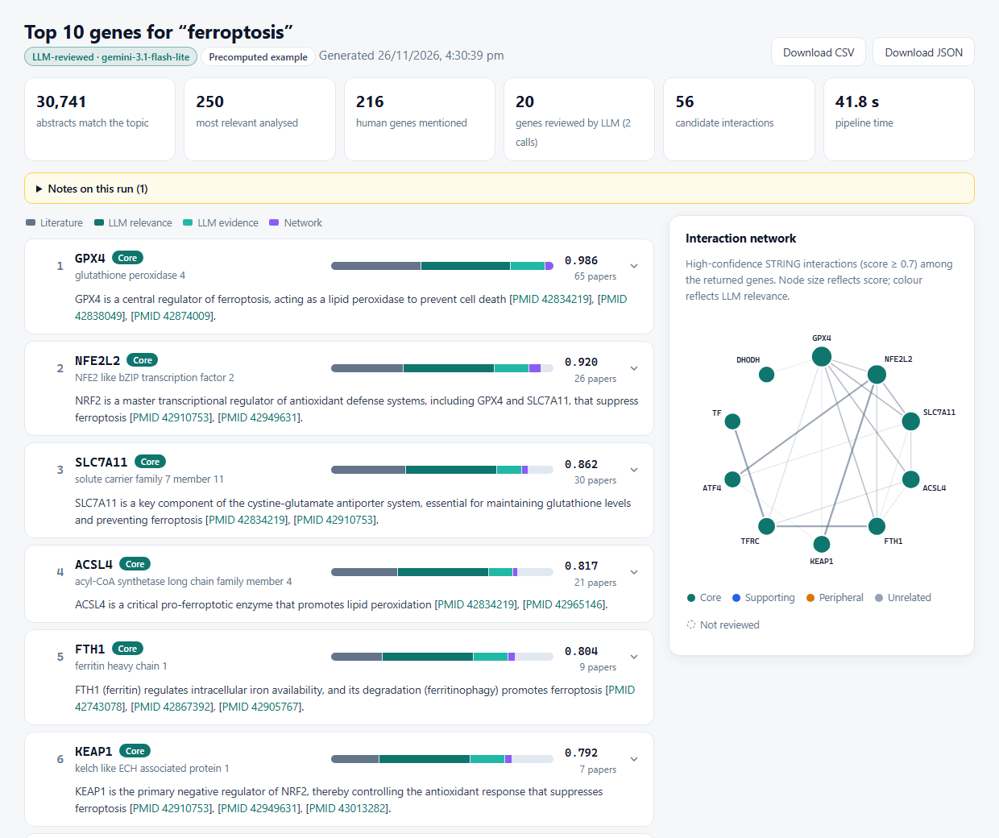
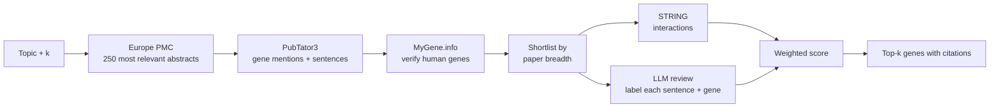

# Gene Prioritizer

**Enter a biomedical topic and a number _k_. Get the top-_k_ human genes, ranked from PubMed literature with LLM evidence review and a citation for every claim.**

🔗 **Live demo:** https://ramya2003-cyber.github.io/gene-prioritization/ &nbsp;·&nbsp; **API docs:** https://gene-prioritizer-api.onrender.com/docs



## Try it
1. Open the live demo, type a topic (e.g. `ferroptosis`, `Alzheimer's disease`, `hypoxia`) and choose _k_ (1–50).
2. Watch the live progress. Results show each gene's LLM relevance label, a one-line rationale with PubMed links, the exact evidence sentences, a score breakdown and an interaction network. They can be exported as CSV or JSON.
3. The three example chips load instantly. A new topic takes about 1–2 minutes. The free server sleeps when idle, so the first search after a break needs about a minute more.

## Where the LLM is used
Text mining finds *which* genes a set of abstracts mentions. It cannot tell whether a mention is a real finding about the topic or an incidental one. That judgement is the LLM's job:

- For each shortlisted gene, the model (Gemini, through an OpenAI-compatible API) receives the topic and up to three **exact sentences** in which the gene appears.
- It returns strict JSON:
  - a **relevance label** for the gene: core, supporting, peripheral or unrelated
  - an **evidence label** for each sentence: direct finding, indirect, or background
  - a short **rationale** that cites the sentences. Citations are converted into PubMed IDs, so every claim can be checked.
- These labels make up 55% of the final score.

**Example (ferroptosis):** ranked by paper count alone, the top 10 includes a mis-tagged abbreviation, ATL1 (#6), and the general signalling genes AKT1 (#8) and TP53 (#10). The LLM labelled ATL1 *unrelated* and AKT1 and TP53 *supporting*. They fell to #20, #14 and #11, making room for ATF4 and DHODH, which it labelled *core*. The "Other reviewed candidates" table on the results page shows every demoted gene with the model's reason.

### Guardrails
- The model judges **only the sentences it is given**, with temperature 0 and JSON output.
- **Every item is validated.** Unknown genes, made-up passage IDs and invalid labels are dropped and listed in the run notes.
- **Failures degrade gracefully.** A failed or rate-limited batch affects only its own genes, which fall back to literature signals, and the page says so.
- **No gene is invented.** If fewer than _k_ human genes are found, the shortfall is reported.
- **Usage is bounded:** at most 4 LLM calls per search, a per-IP hourly limit, a 24 h result cache and a cap on concurrent searches.
- **Provider-agnostic:** any OpenAI-compatible endpoint (Gemini, Mistral, Groq…) works by changing environment variables.

## How it works



```
score = 0.40·literature + 0.40·LLM relevance + 0.15·LLM evidence + 0.05·network
```

The network term is deliberately small, so highly connected "hub" genes such as TP53 or AKT1 cannot outrank genes the literature is actually about.

### How the weights were chosen
The weights are set by hand. I tested them against **learned weights from a pairwise learning-to-rank model**, trained on 251 KEGG pathway cases and evaluated with 5-fold cross-validation by pathway (details in [`training/`](training/README.md)):

| Ranking (held-out pathways) | Gene precision@10 | Pathway R@1 | MRR |
|---|---:|---:|---:|
| Paper count only | 0.580 | 0.725 | 0.799 |
| **Hand-set weights (used)** | **0.631** | 0.777 | 0.836 |
| Learned: literature + evidence | 0.606 | 0.793 | 0.841 |
| Learned: + network signals | 0.650 | 0.701 | 0.778 |

- **Network signals:** the learner gave them a large weight, which selected slightly more pathway members but cut pathway recovery by 7.6 points (statistically significant).
- **Without network signals:** the learned model tied the hand-set weights on pathway recovery but was worse on precision.
- **Result:** the hand-set weights were kept. The LLM relevance term has no saved equivalent, so it is not covered by this test.

## Tech stack

```
frontend/   HTML/CSS/JavaScript, no build step       → GitHub Pages
            live progress (Server-Sent Events), SVG network graph, CSV/JSON export
backend/    Python 3.11, FastAPI                      → Render
  app/literature.py  Europe PMC + PubTator3 + MyGene
  app/llm.py         prompt, batched calls, JSON validation
  app/ranking.py     weighted scoring
  app/pipeline.py    orchestration, caching, progress events
  app/main.py        REST + streaming endpoints, rate limiting
  tests/             offline tests, all external APIs mocked
training/   weight-validation study (learning-to-rank vs hand-set weights)
```

**Run locally:** `pip install -r backend/requirements.txt`, set the environment variable `LLM_API_KEY` to a free Gemini key, then run `uvicorn app.main:app` from `backend/`, and `python -m http.server 5500` from `frontend/`. Tests: `python -m pytest -q` in `backend/`.

## Limitations
- Only the 250 most relevant abstracts are read, so rare or recently reported genes can be missed.
- LLM labels are model judgements, not expert curation. Scores rank literature evidence and are **not** probabilities of causality.
- For research exploration only, not clinical use.

## Background
This app grew out of my research on literature-based gene prioritization. That work compared GF-IDF, learning-to-rank and evolution-strategy rankers on KEGG pathway-recovery benchmarks. The earlier rankers over-rewarded network hub genes on live topics: for example, TP53 ranked #1 for *ferroptosis*, ahead of GPX4. This version adds the LLM evidence layer and caps the network term to fix that.

## License
MIT
